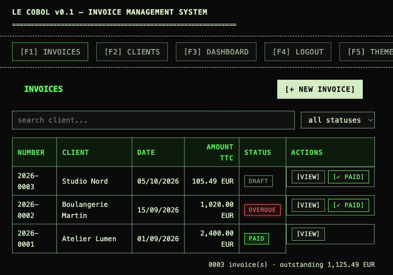
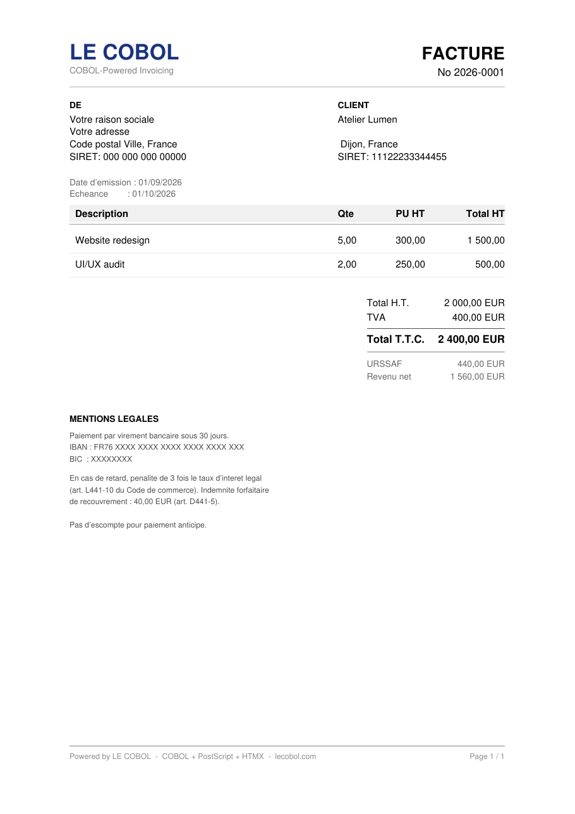

# Le Cobol

**An invoicing web app for French freelancers, written in COBOL.** PDFs are rendered in PostScript, the UI is HTMX, and every request is a COBOL binary behind Apache CGI. No framework, no database server, no npm.

<p align="center">
  
  &nbsp;
  
</p>

## Try it

```bash
git clone https://github.com/FredBourouliou/le-cobol && cd le-cobol
docker build -t lecobol .
docker run --rm -p 8080:80 lecobol
```

Open <http://localhost:8080/login.html> and log in as `admin` with the password printed in the container logs (or pass your own with `-e COBILL_PASSWORD=...`).

## Why COBOL

Floating point loses cents. COBOL has done exact decimal arithmetic by default since 1959, and it still runs much of the world's banking. So the app is built on it:

| Layer | Technology |
|---|---|
| Business logic | GnuCOBOL 3.2 — fixed-point decimals, `3 × 33.33 = 99.99` exactly |
| PDF | Hand-written PostScript, rendered by Ghostscript |
| Server | Apache 2.4 + `mod_cgi`: one compiled binary per endpoint |
| Frontend | HTML + HTMX 2 — the only JavaScript (17 KB gzipped) |
| Storage | ISAM indexed files, native to COBOL |

What it does: client directory with SIRENE lookup (French business registry), invoices with VAT and URSSAF contributions, PDF generation, paid / overdue tracking, session auth with sha512crypt.

## Tests

`Cobill/scripts/smoke-test.sh` runs ~30 end-to-end assertions over HTTP: auth gate, client CRUD, invoice arithmetic, decimal edge cases, PDF magic header, status workflow, overdue detection.

```bash
docker run -d --name lecobol -p 8080:80 -e COBILL_PASSWORD=cobill lecobol
BASE=http://127.0.0.1:8080 Cobill/scripts/smoke-test.sh   # wipes ./data in the current directory
```

## Deploying to a server

See [Cobill/deploy/README.md](Cobill/deploy/README.md) (Ubuntu + Apache + certbot, idempotent setup script).

## Design docs (French)

Problem statement, architecture, data model and sequence diagrams are in [`docs/`](docs/) — start with [04-architecture.md](docs/04-architecture.md) and [15-database-design.md](docs/15-database-design.md).

## License

Copyright (C) 2026 Frédéric Bourouliou. [AGPL-3.0-or-later](LICENSE): self-host it freely; if you run a modified version as a public service, you must publish your changes.

<p align="center">
  
</p>
